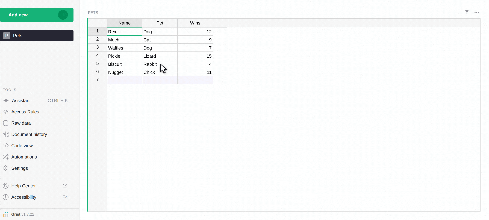
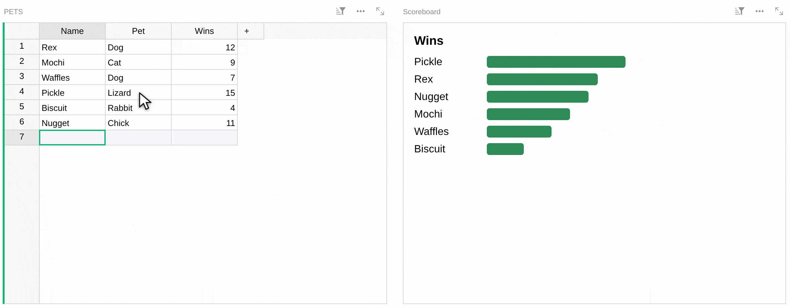
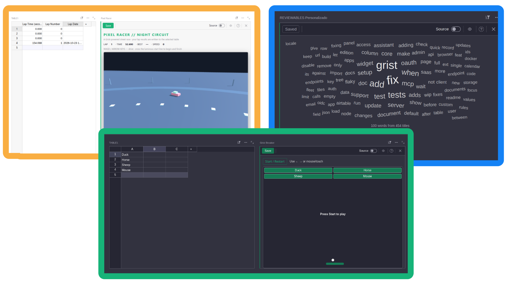
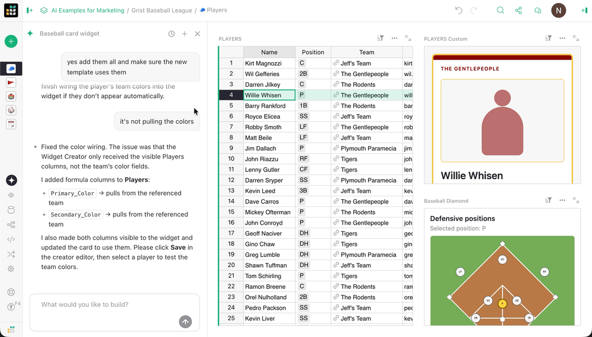
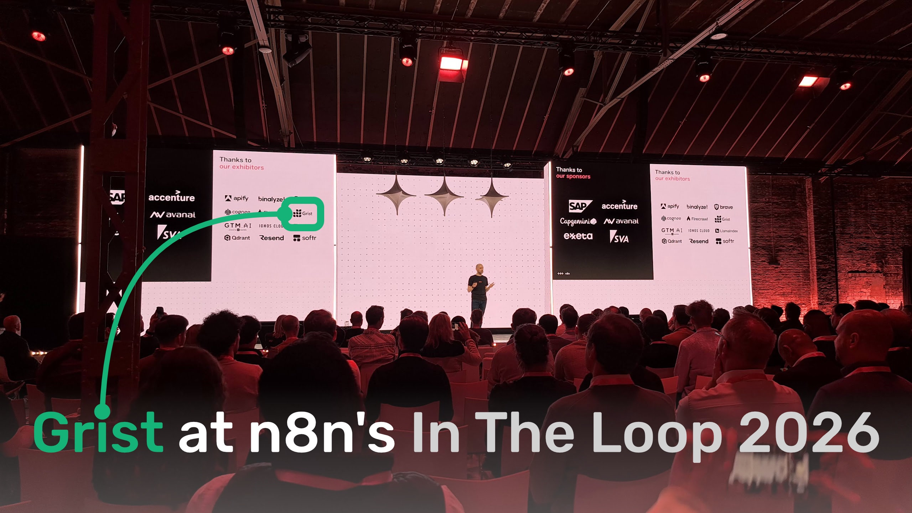
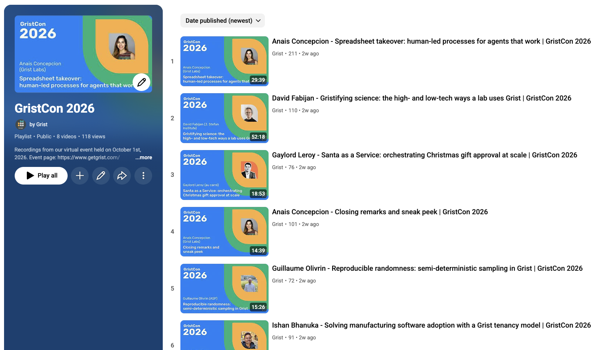
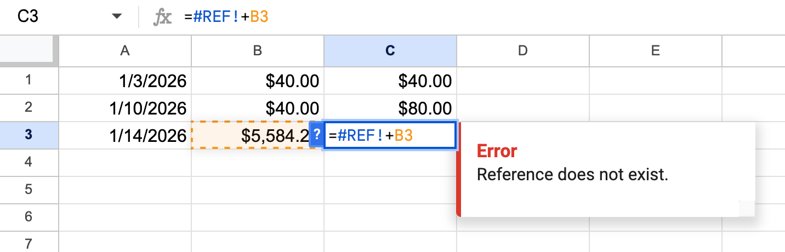
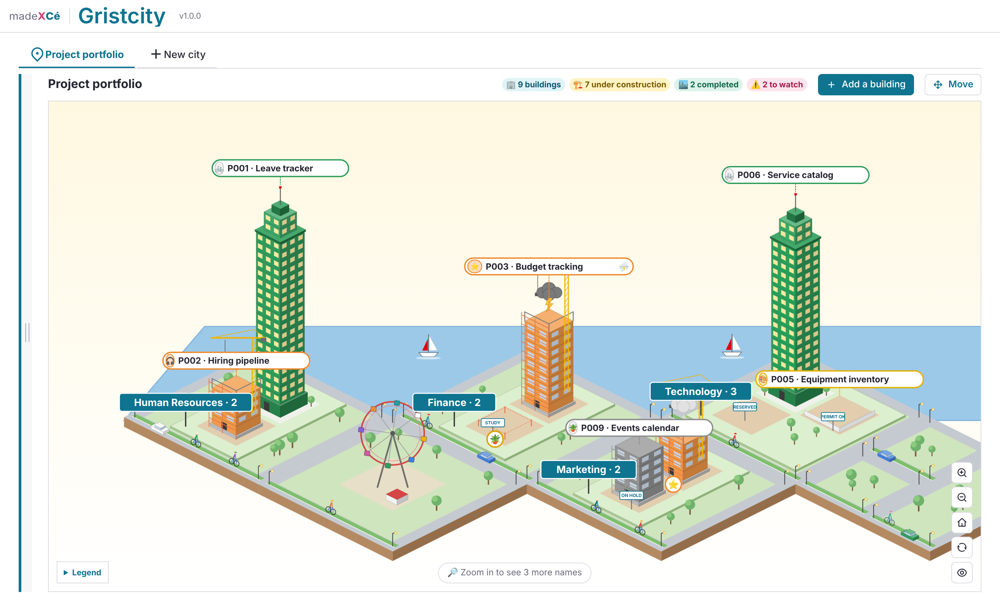
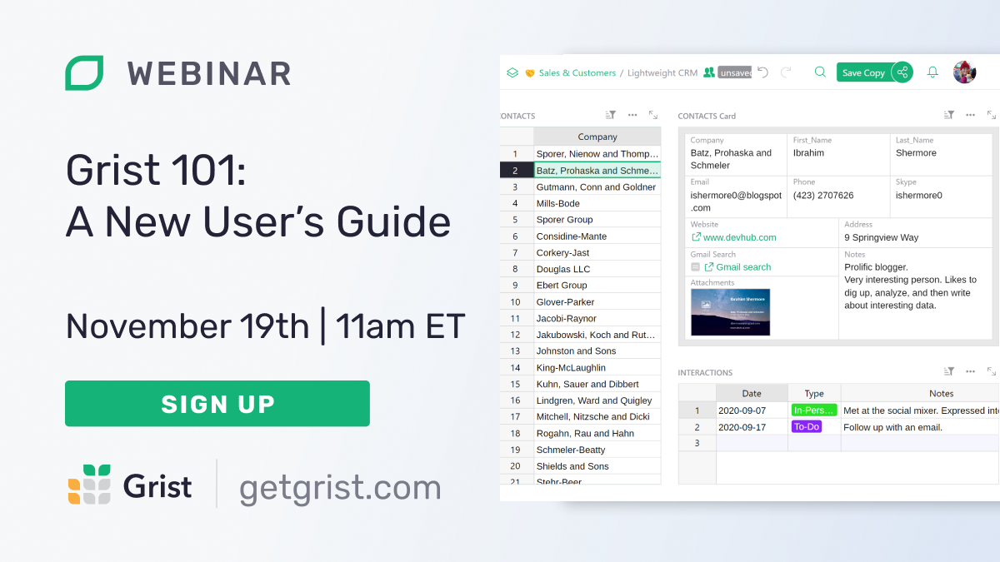

# October 2026 Newsletter

<table class="header" cellpadding="0" cellspacing="0" border="0"><tr>
  <td class="header-text">
    <table class="header-top"><tr>
      <td class="header-image">
        
      </td>
      <td class="header-top-text">
        
Grist for the Mill

        
October 2026
          &#8226; <a href="https://www.getgrist.com/">getgrist.com</a>

      </td>
    </tr></table>
    

      Welcome to our monthly newsletter of updates and tips for Grist users.
    

  </td>
</tr></table>

## What’s new

### New Widget Creator

As [some have found out](https://www.linkedin.com/feed/update/urn:li:activity:7521200320903942144){:target="\_blank"}, there’s a new way to make custom widgets. Custom widgets are becoming more and more central to Grist workflows, so we designed an even easier way to build them. Say hello to the [Widget Creator.](https://support.getgrist.com/widget-creator/){:target="\_blank"}

If you’re new to custom widgets, there’s no better time to jump in. Just select “Create your own” when adding a new widget. You can either prompt the Assistant to start building, or jump straight into editing the HTML/JavaScript. Everything is saved in the document, so you don’t have to worry about separate hosting. Download the `.grist` file, and your custom widgets come with you. 

If you’ve used the old custom widget builder custom widget (what a name!) or Vibe View widget, things will be familiar and more streamlined. A single editor pane handles all the code, and a live preview updates as you make changes. 

We’ve seen some very impressive things in the last few months with custom widgets. Now that building them is easier, we’re expecting even more. Here’s what our engineers came up with while testing: a 3D racing game that tracked lap splits in a table, a wobbly word cloud, and a Breakout game where the blocks are words from a table. Keep reading for examples of more conventional (useful) custom widgets from our community.

### Big improvements to the AI Assistant

In conjunction with the new Widget Creator (and as previewed at GristCon), the AI Assistant has received major updates. You’ll notice a fresh look (it’s a panel, no longer a floating window), but don’t miss some key new features:

* It can read and write Widget Creator code (as a draft to be approved and saved by a human).
* It keeps track of multiple conversations. Search through and manage old chats, and start new ones for fresh context.

### Grist at n8n’s In The Loop conference

From October 13-14, we were delighted to attend [In The Loop](https://n8n.io/intheloop/){:target="\_blank"}, exhibiting Grist and meeting many automation-minded professionals. 

Check out our [follow-up blog post](https://www.getgrist.com/blog/three-perspectives-from-n8ns-in-the-loop-conference/){:target="\_blank"} that shares three perspectives on the event, touching on community-building, partners, and more. You can also check out our [n8n + Grist video tutorials](https://www.getgrist.com/blog/how-to-use-n8n-automations-with-grist/){:target="\_blank"} to see what kind of new workflows are possible.

### GristCon recordings

{:target="\_blank"}

Full recordings of this year’s GristCon sessions are now up [on YouTube!](https://www.youtube.com/playlist?list=PLLmMsWEw2Cs4){:target="\_blank"} A huge thank you to our presenters and attendees.

### Running totals, PREVIOUS(), and ordered lookups

Grist avoids this. 👆

Grist co-founder Dmitry has a great pitch for his [recent blog post](https://www.getgrist.com/blog/running-totals-you-dont-have-to-chase/){:target="\_blank"} on an underrated Grist capability: “An elegant and efficient solution to a common need that traditional spreadsheets address poorly, and modern competitors not at all.”

He also compiled some [helpful documentation](https://support.getgrist.com/ordered-lookups/){:target="\_blank"} that goes into more detail. If you ever do calculations that need a record that you can’t name by a specific value (that involve time intervals or tiers, for example), save yourself a thousand headaches and have a read.

### Help Center, now front and center

Speaking of the Help Center, it’s now just a click away in Grist’s left panel. It opens in a new tab instead of the cramped widget that used to pop up inside Grist itself. The Help Center is a fantastic resource that received a major revamp over the past year led by accessibility hero Emmanuel Pelletier: a clear home page, great search, a layout that’s easy to browse, and tutorials and reference docs side by side. If you haven’t been in a while, [reunite with knowledge.](https://support.getgrist.com/){:target="\_blank"}

### Security updates

Surfacing relevant security updates from our release notes as security has been on everyone’s mind this month: 

* Grist Docker images run Node.js 22.23.4, which fixes [CVE-2026-111497](https://github.com/advisories/GHSA-9v8h-qqgm-4m35){:target="\_blank"} (remote code execution through brotli-compressed responses) and stops trusting the compromised eMudhra certificate authorities. Images pulled since October 22 already had these fixes; 1.7.22 is the first numbered release with them.
* Dependency updates for security advisories, including shell-quote 1.12.0 ([#2642](https://github.com/gristlabs/grist-core/pull/2642){:target="\_blank"}), handlebars 4.7.10 ([#2638](https://github.com/gristlabs/grist-core/pull/2638)), and proxy-addr 2.0.8 ([#2639](https://github.com/gristlabs/grist-core/pull/2639){:target="\_blank"}).

Two releases again this month, though the first is a small one: [v1.7.21](https://github.com/gristlabs/grist-core/releases/tag/v1.7.21){:target="\_blank"} and [v1.7.22](https://github.com/gristlabs/grist-core/releases/tag/v1.7.22){:target="\_blank"}. Click through for complete release notes.

## Community highlights

* If you’re looking for advanced widget building with AI’s help, ANUPRESS has shared three complex Grist widgets on the community forum recently, and has been sticking around to answer user questions: [Advanced Charts](https://community.getgrist.com/t/showcase-new-advanced-charts-a-no-code-dashboard-widget-for-grist-by-anupress/13998){:target="\_blank"}, [Invoice Studio](https://community.getgrist.com/t/showcase-invoice-studio-an-invoicing-and-e-invoice-widget-for-grist-by-anupress/14153){:target="\_blank"} and now [File Studio](https://community.getgrist.com/t/showcase-file-studio-the-files-in-your-attachments-columns-on-one-wall-free-widget-by-anupress/14220){:target="\_blank"}.
* More wild widget building going on by [cezionlyone on GitHub](https://github.com/cezionlyone/grist-widgets){:target="\_blank"}, who has a suite of custom widgets including the delightful Gristcity, which draws a table as an isometric 3D city!

## Learning Grist

### Webinar – Grist 101: A New User’s Guide

Join us for an introductory webinar designed to help new users navigate the basics of Grist. This session will provide you with the essential tools and knowledge to get started. We'll cover key features and best practices to maximize your productivity. Perfect for beginners, this webinar will set you on the path to becoming a Grist pro. Don't miss out—reserve your spot today!

{:target="\_blank"}

**Thursday November 19th at 11:00am US Eastern Time.**

[SIGN-UP FOR NOVEMBER'S WEBINAR](https://www.getgrist.com/webinars/grist-101-new-users-guide-nov-2026/?utm_source=support-newsletter&utm_medium=internal&utm_campaign=build-webinar&utm_term=november-2026){:target="\_blank"}
{: .grist-button}

### Migrating from Excel to Grist using MCP

Moving on from that critical spreadsheet that kept existing despite its many problems and frustrations has never been easier. In our October webinar, Anais walked through migrating a complex Excel document to Grist with the help of AI. She kept the good data, eliminated the frustrations, and improved the structure for long-term iteration and improvement. 

[WATCH OCTOBER'S RECORDING](https://www.getgrist.com/webinars/migrating-from-excel-to-grist-using-mcp/){:target="\_blank"}
{: .grist-button}

## Help spread the word
If you’re interested in helping Grist grow, consider leaving a review on product review sites. Here’s a short list where your review could make a big impact. Thank you!

* [AlternativeTo](https://alternativeto.net/software/grist/about/){:target="\_blank"}
* [Capterra](https://www.capterra.com/p/232821/Grist/){:target="\_blank"}
* [G2](https://www.g2.com/products/grist){:target="\_blank"}
* [TrustRadius](https://www.trustradius.com/products/grist/){:target="\_blank"}

## We are here to support you

**Solutions.** Grist often surprises people with its capabilities. Schedule a **free** call to assess your needs and help connect you with a Grist expert. [Learn more.](https://www.getgrist.com/solutions/){:target="\_blank"}

**Have questions, feedback, or need help?** Search our [Help Center](../index.md){:target="\_blank"}, [watch video tutorials](https://www.youtube.com/channel/UCx0ioQrrC-bIrkmZ7ZULr0g/playlists){:target="\_blank"}, share ideas in our [Community Forum](https://community.getgrist.com){:target="\_blank"}, or contact us at <support@getgrist.com>.