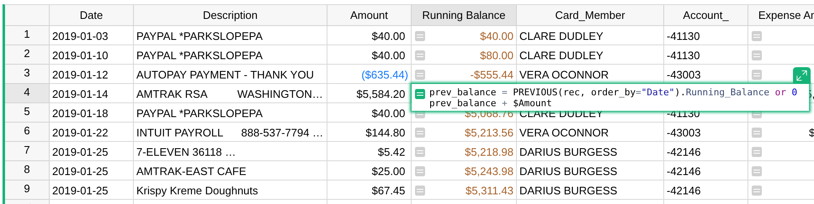
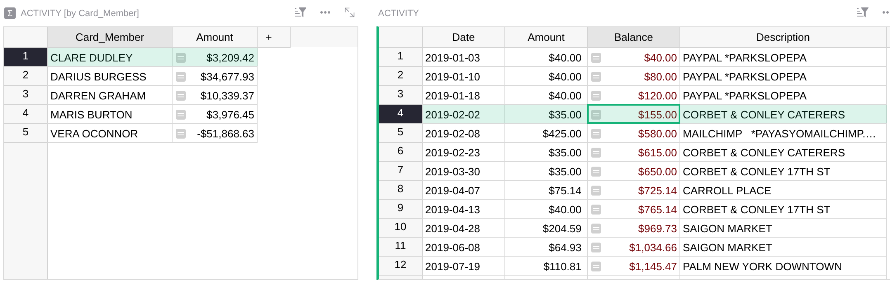
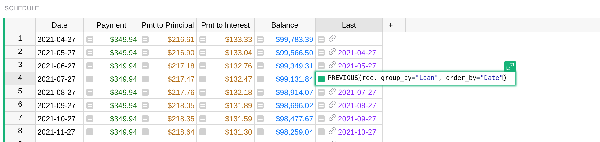
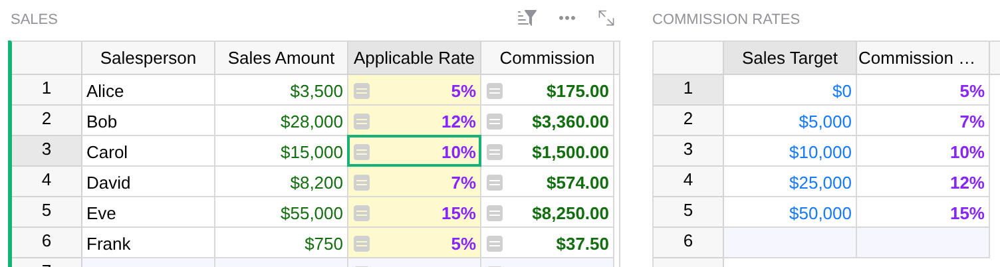

Running totals, previous records, and nearest matches
=========

Most Grist formulas use values from the same record (`$Amount * $Rate`), from a referenced
record (`$Person.Name`), or from records found by an exact match (`Sponsors.lookupOne(Email=$Email)`).
See [References and lookups](references-lookups.md) for those.

Some calculations need a record that you can't name by an exact value. You only know where it falls
in some order:

- The **previous transaction**, to add up a running balance or any cumulative total.
- The **rate in effect** on a given date, from a history of rates.
- The **tier** that an amount falls into, for commissions, shipping, discounts, or tax brackets
  (an approximate match, in spreadsheet terms).
- The **latest** or **earliest** record in a group, like a customer's most recent order.
- A record's **rank**, like whether a sale is among the ten largest.

Grist has a few functions for these: [`PREVIOUS`](functions.md#previous),
[`NEXT`](functions.md#next), and [`RANK`](functions.md#rank) for cumulative calculations, and
the `order_by` parameter of lookups together with the [`find.*`](functions.md#find_) methods for
nearest matches. We call the whole family "ordered lookups", because each one sorts records in
an order that you state in the formula.

Each one gives you three things:

1. **Correctness that doesn't depend on the view.** A traditional spreadsheet's "previous row" is
   whatever row sits above on screen, so sorting or inserting rows can quietly break the math. In
   Grist, the order is part of the formula, so sorting, filtering, or rearranging a view never
   changes the results.
2. **Simple formulas.** Each of these jobs takes a line or two.
3. **Speed.** Grist keeps the looked-up records sorted and finds what you need with a binary
   search, so these formulas stay fast with tens of thousands of records, where hand-rolled
   loops can get very slow. There's more on this [below](#why-not-plain-python).

!!! note "Prefer video?"
    The webinar
    [Advanced formulas with ordered lookups](https://www.getgrist.com/webinars/advanced-formulas-with-ordered-lookups/){: target="\_blank"}
    covers the same material, with a guided walkthrough of the examples on this page.

## Running totals with PREVIOUS

The [Credit Card Activity](https://public.getgrist.com/tJZu9JGmB7Bh/Credit-Card-Activity/m/fork/p/1){: target="\_blank"}
example has a table of transactions with a **Date** and an **Amount**. To get a running balance, each
record needs the balance from the record before it, plus its own amount. That's the formula in
the **Running Balance** column:

```python
prev_balance = PREVIOUS(rec, order_by="Date").Running_Balance or 0
prev_balance + $Amount
```

<span class="screenshot-large">**</span>

Here's what's going on:

- `PREVIOUS(rec, order_by="Date")` sorts the table by **Date**, finds where the current record
  (`rec`) falls, and returns the record just before it. Note that `"Date"` is the column's ID in
  quotes, not `$Date`.
- The result is a record, like a value in a [Reference column](col-refs.md), so you can use dot
  notation to get any field from it. Here, `.Running_Balance` is the balance of the previous
  transaction.
- The first record has no previous record. `PREVIOUS` returns an empty record, and its
  **Running Balance** is empty. The `or 0` turns that into zero, so that the addition works.

!!! tip "Numeric columns don't need `or 0`"
    If the **Running Balance** column has the type Numeric, the empty record's `.Running_Balance` is
    `0` rather than empty, so `or 0` isn't needed. If the column has the type Any, leaving out
    `or 0` leads to an error like "TypeError: unsupported operand type(s) for +: 'NoneType' and 'float'".

Try sorting this table by **Amount**, or filtering it, or adding a page that shows the same data
differently. The running balance stays the same in each record: it's always the balance in
**Date** order, because that's what the formula says.

## Running totals per group with group_by

Transactions for different accounts, people, or categories belong in the same table. To keep a
separate running balance for each, add `group_by`. The Credit Card example has a second running
total, in a column named **Balance**, which keeps a separate balance for each card member:

```python
prev_balance = PREVIOUS(rec, group_by="Card_Member", order_by="Date").Balance or 0
prev_balance + $Amount
```

`PREVIOUS` now finds the previous record by **Date** among the records with the same **Card_Member**
as the current one.

On the _By Card Member_ page, selecting a card member shows just their transactions, and the
**Balance** column adds up as you'd expect:

<span class="screenshot-large">**</span>

!!! warning "Show each running total where it makes sense"
    A formula's value doesn't depend on the view, so a per-member balance is the same wherever
    you see it. In a view that mixes transactions from several card members, the **Balance** column
    jumps around, because each row continues its own member's total. That's correct, but
    confusing. Show a grouped running total in views filtered or linked to one group, and show
    the overall running total in views of the whole table.

## Using the whole previous record

When several formulas need the previous record, it helps to put it in a column of its own. The
[Loan Tracker](https://public.getgrist.com/tBaUEP2x4eML/Loan-Tracker/p/3){: target="\_blank"}
example computes a loan's amortization schedule, where each payment's interest and principal
depend on the balance left after the previous payment. Its *Schedule* table has a column called
**Last**, with the formula:

```python
PREVIOUS(rec, group_by="Loan", order_by="Date")
```

The column type is set to Reference to the *Schedule* table itself, so each row points to the
payment before it in the same loan:

<span class="screenshot-large">**</span>

Other formulas then use `$Last` like any reference. For example, this formula gives the starting
principal in each payment row:

```python
$Last.Outstanding_Principal if $Last else $Loan.Initial_Amount
```

For the first payment of a loan, `$Last` is empty, so the formula falls back to the loan's initial
amount.

## Sort order options

The `group_by` and `order_by` parameters accept a few variations:

- **Descending order**: prefix a column ID with a minus sign, as in `order_by="-Date"` for newest
  first, or `order_by="-Amount"` for largest first.
- **Several columns**: use a tuple, as in `group_by=("Account", "Category")` or
  `order_by=("Date", "-Amount")`. Records are sorted by the first column, then by the next one to
  break ties.
- **Manual row order**: use `order_by=None` to follow the order in which rows appear in the
  table when it isn't sorted, including any rows you've dragged into place.

When several records have the same `order_by` values, such as two transactions on the same date,
they are ordered by their position in the unsorted table. That's also how Grist breaks ties when
you sort a view, so in an unfiltered view sorted by **Date**, the previous record is the row just
above.

The same options work for `NEXT`, `RANK`, and the `order_by` parameter of `lookupOne` and
`lookupRecords`.

## NEXT and RANK

[`NEXT`](functions.md#next) is the mirror image of `PREVIOUS`: it returns the following record
rather than the previous one. You'll rarely need it, since `PREVIOUS` with a reversed order does
the same thing.

[`RANK`](functions.md#rank) returns a record's position in the sorted order, starting with 1. For
example, this formula is true for the ten largest transactions:

```python
RANK(rec, order_by="-Amount") <= 10
```

With `group_by`, the rank counts within each group, so `RANK(rec, group_by="Card_Member",
order_by="-Amount") == 1` marks each member's largest transaction.

## Nearest matches with find.le and friends

The second kind of ordered lookup finds the record nearest to a value. Take the
[Payroll example](examples/2020-09-payroll.md): each person's hourly rate can change over time,
and the *Rates* table keeps the history, with the date each rate started. Every payroll entry
needs the rate in effect on its own date, which is the latest rate that started on or before that
date.

```python
rates = Rates.lookupRecords(Person=$Person, Role=$Role, order_by="Rate_Start")
rates.find.le($Date).Hourly_Rate
```

This takes two steps:

1. `lookupRecords(..., order_by="Rate_Start")` returns this person's rates for this role,
   sorted by **Rate Start**.
2. `.find.le($Date)` finds the last record in that sorted list whose **Rate Start** is less than or
   equal to (`le`) the payroll date. That's the rate in effect on that date.

The value passed to `find.le` is compared with the `order_by` column, here **Rate Start**.

Dates are common, but anything that can be sorted works. The
[Sales Commissions](https://public.getgrist.com/b2ojPRLB5DYJ/Sales-Commissions/p/1){: target="\_blank"}
example has a table of tiers, where reaching each **Sales Target** earns a higher
**Commission Rate**. To find the rate for each salesperson:

```python
rates = Commission_Rates.lookupRecords(order_by="Sales_Target")
rates.find.le($Sales_Amount).Commission_Rate
```

`lookupRecords` with no field arguments returns all records of the table, here sorted by
**Sales Target**. For Carol's $15,000 in sales, the last tier at or below that amount is $10,000, so
her rate is 10%:

<span class="screenshot-large">**</span>

The same approach works for shipping rates, volume discounts, tax brackets, or exchange rates in
effect on a date (use `Exchange_Rates.lookupRecords(Currency=$Currency, order_by="Date")`). If
you're coming from Excel or Google Sheets, this is the job of `VLOOKUP` with approximate
matching, without the requirement to keep the lookup table sorted.

There are five `find` methods. "Less" means "earlier in the sort order", and "greater" means
"later":

| Method | Finds |
|--------|-------|
| `find.le(value)` | The last record whose sort value is less than or equal to `value`. |
| `find.lt(value)` | The last record whose sort value is strictly less than `value`. |
| `find.ge(value)` | The first record whose sort value is greater than or equal to `value`. |
| `find.gt(value)` | The first record whose sort value is strictly greater than `value`. |
| `find.eq(value)` | The first record whose sort value equals `value`. |

If no record qualifies, as when a sales amount is below the lowest tier, the result is an empty
record. Its fields have their column's default value: zero for Numeric columns, empty for most
others.

If `order_by` lists several columns, pass a value for each, as in
`Targets.lookupRecords(order_by=("Year", "Week")).find.le($Year, $Week)`.

## First and last records with lookupOne

To get the first or last record in a group, you don't need `find` at all. `lookupOne` returns the
first matching record, and `order_by` determines which one is first. For a customer's most recent
order:

```python
Orders.lookupOne(Customer=$id, order_by="-Date")
```

The minus sign sorts by **Date** descending, so the first record is the latest. Without the minus,
you get the customer's first order. In the Payroll example, you could add this formula to the
*People* table to show each person's most recent rate:

```python
Rates.lookupOne(Person=$id, order_by="-Rate_Start").Hourly_Rate
```

See also [lookupOne and order_by](references-lookups.md#lookupone-and-order_by).

## Why not plain Python?

Grist formulas are Python, so you could write any of these calculations with a plain loop. Why
bother with special functions? The crucial difference is speed.

Here's a running total that loops over the table:

```python
SUM(r.Amount for r in Transactions.all if r.Date <= $Date)
```

This gives the right total, except when several transactions share a date, since they all get
the same total. Worse, each record looks at every record in the table. With 1,000 transactions,
that's 1,000 × 1,000, or a million steps. With 20,000 transactions, it's 400 million. (If you've
studied algorithms, that's quadratic complexity, or O(N²).)

Ordered lookups avoid that. Grist keeps the looked-up records sorted. To find where a record
falls, it does a fast binary search, the way you'd look up a word in a paper dictionary. For the
whole table of 20,000 records, that's over 1,000 times fewer steps than the loop. (That's
O(N log N) complexity.)

In a test with 20,000 transactions, `PREVIOUS` computed the whole column of running balances in a
few seconds. The loop version was still running after five minutes.

Ordered lookups are also easier to read, for you and for the next person who has to understand
the formula.

If a document feels slow, the [formula timer](formula-timer.md) shows which formulas take the
most time. Formulas that scan whole tables, or have any kind of loop inside, are good candidates
to rewrite with ordered lookups.
