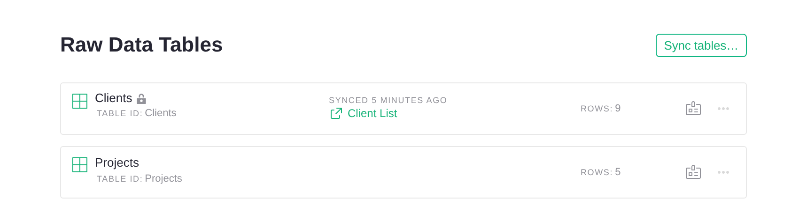
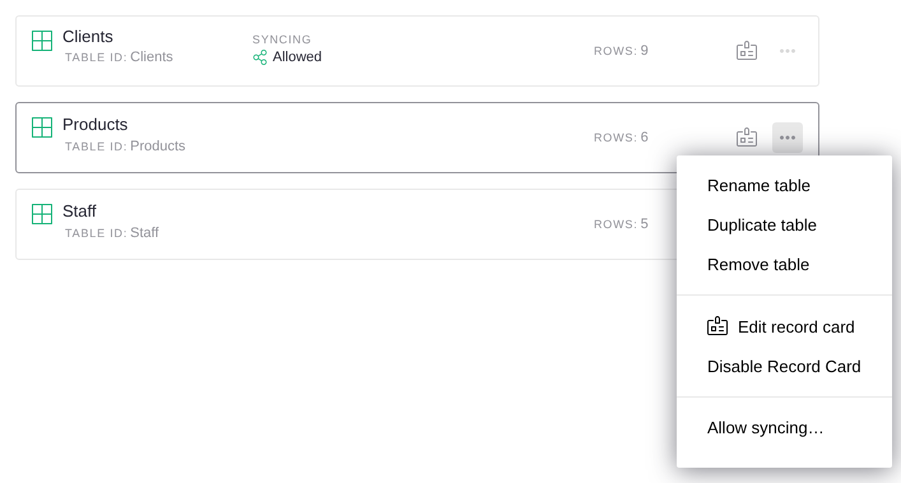
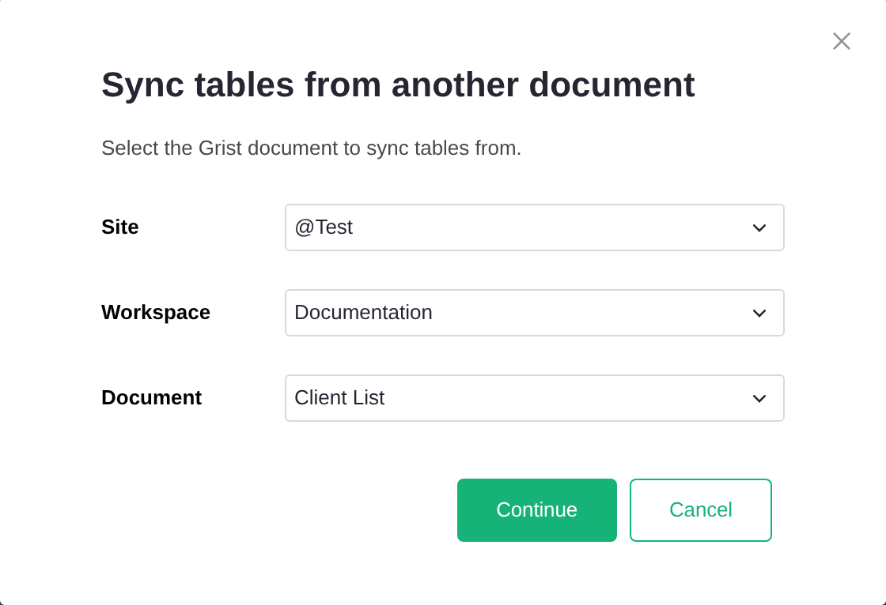
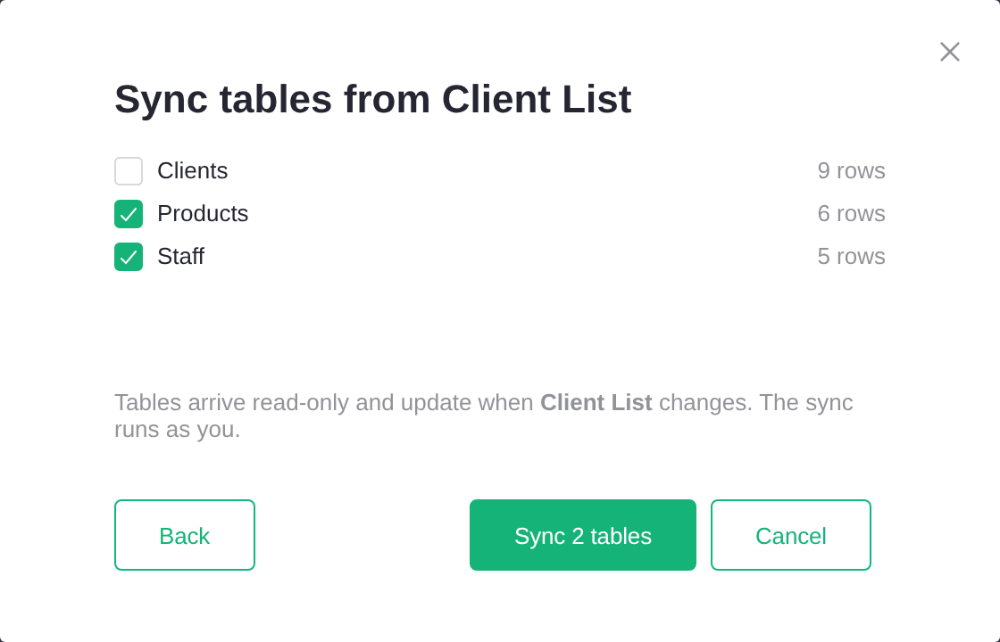
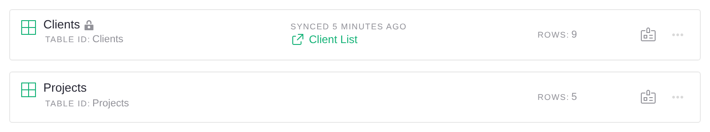
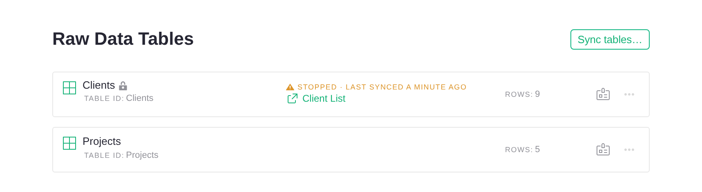
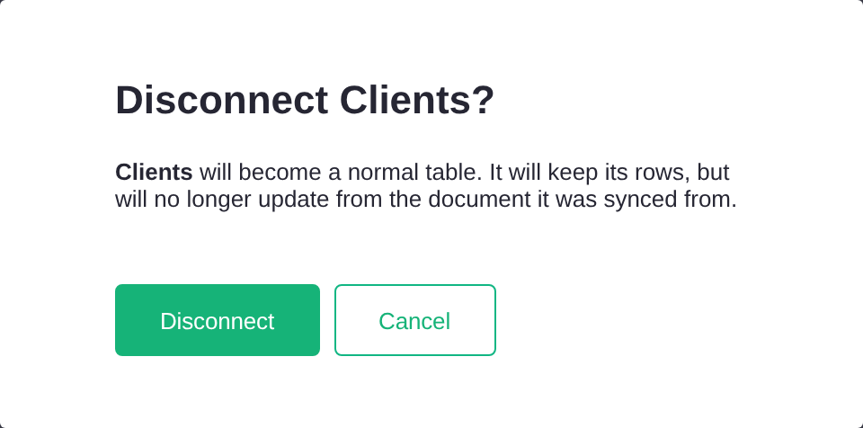

# Syncing tables from other documents

You can keep read-only copies of tables from other Grist documents in your current document by creating a **sync**.
These synced tables are automatically updated whenever the source document's tables change.
This is useful for keeping one shared list – such as clients, products, or staff – in a single document,
and using it from many others.

Synced tables are managed entirely by Grist. You cannot edit their data, add or
remove columns, or delete the table. You can still show the data in
[pages and widgets](page-widgets.md), add [summary tables](summary-tables.md), access the data
from formulas in other tables, and customize how they're displayed.

**

If you need editable, independent copies of a table, you can do a
[one-time copy of tables from another document](copying-docs.md#copying-data-from-another-document).

!!! note "Beta availability"
    Table syncing is a beta feature. Some of its current [limits](#limits) may be removed in
    future versions. It is available on Business plan and above, as well as in the full
    edition of self-hosted Grist.

## What stays in sync

Synced tables mirror their source tables' rows and columns, including their types, labels and formatting.
Syncing does not include related Grist features such as pages, widgets, or [access rules](access-rules.md), which are configured
independently in each document.

Most cell values in Grist are compatible with table syncing. Some, such as errors, are copied
as text. All Grist column types are supported, except for:

- Reference
- Reference List
- Attachment 

Formula columns cannot be synced either. See [limits](#limits) for more information.

Updates to synced tables happen on their own whenever the source document changes, typically within a minute.

!!! note
    Synced tables read the source document with the access of the user who set it up.
    If they lose access to the source document or your current document, 
    the sync will be unable to run and marked as 'Stopped'.

## Allowing syncing from a table

Before a source document's table can be used for syncing, an editor of the source document with permission to
[modify its structure](access-rules.md) must allow it.
To allow syncing, open the [Raw data](raw-data.md) page, click the three-dot menu next to the table, and select
'Allow syncing…'.

!!! warning
    Allowing syncing enables people with 'Viewer' access to that document to create synced copies of
    that table in their own documents. These people will be able to share that copy (and all future updates) 
    with others.

**

Anyone who can view the source document can then sync the table into their own documents. The table
is marked 'Allowed' on the Raw data page. A table that others can sync:

- cannot be renamed
- cannot have references to other tables (see [limits](#limits))
- cannot have formulas (see [limits](#limits))
- cannot have data hidden with [access rules](access-rules.md)

Due to the formula restrictions, you cannot sync from a [summary table](summary-tables.md).

### Disabling syncing

To disable syncing from a table, a user with permission to [modify the document's structure](access-rules.md) can select
'Disable syncing…' from the same menu. Documents that sync from that table stop getting updates from it, but keep the
rows they already have.

## Adding syncs to your document

To set up a new sync, you must be an owner of your current document. You will need unrestricted read access to the
source tables, and those tables must [allow syncing](#allowing-syncing-from-a-table).

Open the Raw data page and click 'Sync tables…' above the list of tables. Then:

1. Select the site, workspace, and document to sync from, and click 'Continue'.
2. Check the tables you want. Only tables that allow syncing are listed, with their row
   counts.
3. Click 'Sync tables'.

**

**

This will prepare the first sync, and the new tables will appear in your current document after a short delay. 
For larger tables, this may take some additional time.

## Checking the status of your synced tables

You can view the status of each synced table on the Raw data page. Each table shows when it last synced,
with a link to the source document it comes from. The link is only shown to people who can open the source document, and
only owners of the current document can see the time and status.

**

When a sync cannot run anymore, its tables show 'Stopped' with a warning icon on the Raw data
page. The tables keep their rows and stay read-only. A sync stops when:

- the person who set it up lost access to the sync's source tables, or is no longer
  an owner of the current document
- the source document was deleted
- syncing was disabled on the source table
- a column that cannot sync yet, such as a formula column, was added to the source table

**

### Manually triggering a stopped sync

Once the cause is fixed – for example, access is restored – you can select 'Sync tables…' and 
'Sync all now' on the 'Raw data' page. This will cause all synced tables to try to update 
from the source document. Alternatively, you can wait for the next source document change.

If the sync cannot be fixed, you can [disconnect the tables](#disconnecting-synced-tables).

## Disconnecting synced tables

Disconnecting a synced table turns it back into a normal table, similar to 
[detaching a summary table](summary-tables.md#detaching-summary-tables). To disconnect a synced table, 
open the Raw data page, click the three-dot menu next to the table, and select 'Disconnect…'. 
Only owners of the current document can disconnect.

**

Disconnecting applies to all tables that were synced together in one step – the confirmation
lists them. The tables keep their rows and columns and become editable, but no longer get
updates.

## Limits

These limits currently apply to syncing:

- A sync is limited to 10,000 rows in total across its tables.
- Tables in the source document with access rules cannot be synced.
- Tables with formula columns, Reference or Reference List columns, or Attachment columns
  cannot be synced yet. Columns with a
  [trigger formula](formulas.md#trigger-formulas) can, acting as plain data columns.
- A document can be a source document (allow syncing from its tables), or a destination document (sync tables in), 
  but not both.
- You can sync from a document on a different team site, but not from a different Grist
  installation.
