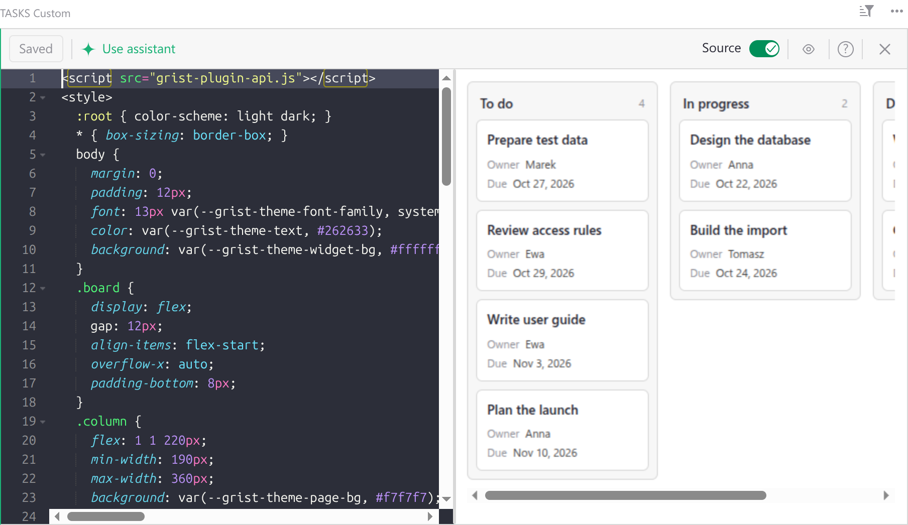
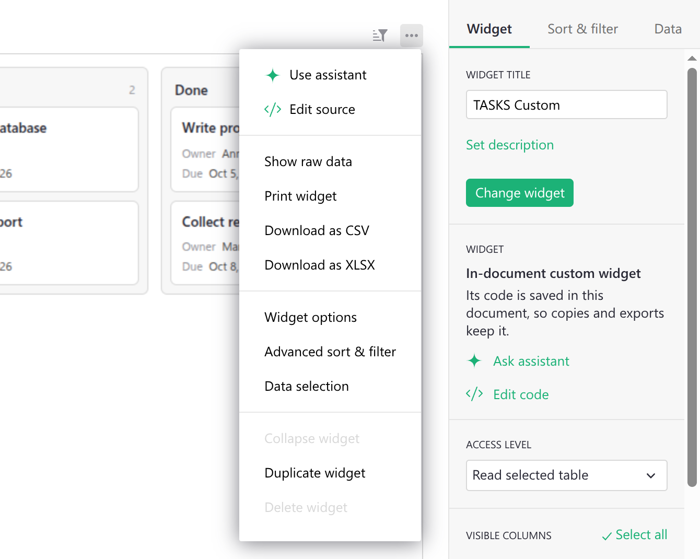
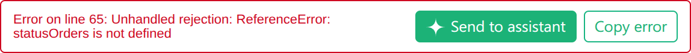
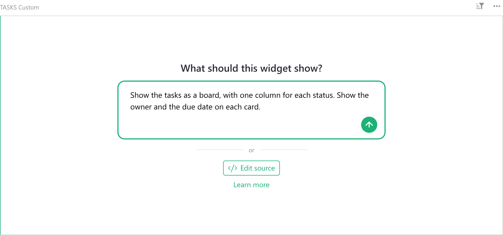
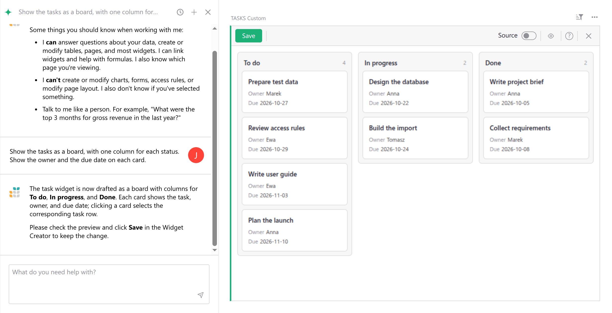

# Page widget: Widget Creator

**Widget Creator** lets you add a widget that you build yourself, with HTML and JavaScript.
Grist saves the code in the document, so copies and exports of the document keep the widget.
You do not need a web server, as you do for a [Custom widget](widget-custom.md).

**

!!! tip "Did you know?"
    If the AI Assistant is available, it can write the code of the widget for you. See
    [Building widgets with the Assistant](#building-widgets-with-the-assistant).

Add a Widget Creator widget from the **Add New** menu. In the list of widgets, it is called
**Create your own**.

## Writing the code

To write or change the code, click **Edit source** in the empty widget, or open the widget menu
(the three dots at the top right of the widget) and select **Edit source**. You can also click
**Edit code** on the **Widget** tab of the Creator Panel.

**

The editor opens inside the widget, with a bar at the top:

* **Save** saves the code in the document. You can also press
  <code class="keys">*Ctrl* + *S*</code> (Mac: <code class="keys">*⌘* + *S*</code>). The button
  shows **Saved** when there are no changes to save, and **Empty** when the widget has no code.
* **Use assistant** opens the Assistant panel, if the Assistant is available.
* **Source** shows or hides the code next to the widget.
* <span class="grist-icon" style="--icon: var(--icon-EyeShow)"></span> hides or shows the widget,
  so the code can use the whole width.
* The question mark shows a short description of Widget Creator.
* The cross closes the editor.

The widget runs your changes a moment after you stop typing. Other users of the document see the
new code only after you save it. If you close the editor with changes that are not saved, Grist
asks if you want to save them.

To save the code, you need permission to edit the structure of the document. Owners have it.
Editors have it too, unless the access rules of the document turn it off. See
[Allow Editors to edit structure](access-rules.md#lock-down-structure).

If the widget is too narrow, the bar shows only **Save**, an expand icon and the cross. Click the
expand icon to see the editor on the whole page.

The code is one HTML page. It must load the Grist plugin API, the JavaScript library that lets the
widget read and change data, and tell Grist which data it needs. Here is a short example that
shows the rows of the table as a list:

```html
<script src="grist-plugin-api.js"></script>
<ul id="list"></ul>
<script>
  grist.ready({ requiredAccess: "read table" });
  grist.onRecords(function (records) {
    document.getElementById("list").innerHTML =
      records.map(r => `<li>${r.Task}</li>`).join("");
  });
</script>
```

Use the address `grist-plugin-api.js` as it is. Grist serves the plugin API itself, so the
widget does not depend on any other server.

Widget Creator uses the same plugin API as a Custom widget. To learn more, see:

* [Creating a custom widget](widget-custom.md#creating-a-custom-widget): `grist.ready`,
  `grist.onRecords` and `grist.onRecord`.
* [Access level](widget-custom.md#access-level): what the widget can do with the document.
  Unlike a Custom widget, which starts with *No document access*, a new Widget Creator widget
  starts with *Read selected table*.
* [Column mapping](widget-custom.md#column-mapping): let users pick the columns the widget uses.
* [Widget options](widget-custom.md#widget-options): save the settings of the widget.
* [Custom Widget linking](widget-custom.md#custom-widget-linking): select rows in other widgets.
* [Plugin API reference](code/modules/grist_plugin_api.md): all functions of the plugin API.

## Fixing errors

When the code fails, the editor shows the error and its line under the widget. Click
**Copy error** to copy the text of the error. If the AI Assistant is available, click
**Send to assistant** to ask it to fix the error for you.

**

## Building widgets with the Assistant

If the [AI Assistant](assistant.md) is available, it can write the code for you. An empty widget
asks **What should this widget show?** Type what you want to see, and press
<code class="keys">*Enter*</code>.

**

The Assistant panel opens, and the Assistant writes the code. The widget runs the new code at
once, so you can check the result. The code is a **draft**: Grist saves nothing in the document
until you click **Save**.

**

To change the widget, write to the Assistant again, for example "Sort the cards by due date" or
"Show overdue tasks in red". Each answer updates the draft. Click **Save** when you like the
result.

You can also ask the Assistant about a widget that already has code:

* In the widget menu, select **Use assistant**.
* In the editor, click **Use assistant**.
* When the code fails, click **Send to assistant** next to the error.

An AI agent connected through the [Grist MCP server](mcp.md), for example Claude or ChatGPT, can
also add a Widget Creator widget and write its code. Ask it, for example "Add a widget to the
Tasks page that shows the tasks as cards". There is no draft in this case: the agent saves the
code in the document at once, and all users see it.

[Learn more about the Assistant](assistant.md), its credits, and how it uses your data.

## Widget Creator for self-hosters

Widget Creator is available in all editions of Grist. Without the Assistant, you can write the
code yourself with **Edit source**.

To use the Assistant, enable the full edition of Grist and set up the Assistant. See
[Assistant for self-hosters](install/assistant.md).

## Moving from the Custom Widget Builder

Before Widget Creator, many users built their widgets with the
[Custom Widget Builder](newsletters/2024-10.md#custom-widget-builder-widget), a custom widget from
the widget gallery. You can move such a widget to Widget Creator. Grist keeps its HTML and
JavaScript code:

1. Click the widget and open the Creator Panel.
2. On the **Widget** tab, click **Change widget**.
3. Select **Create your own**, and click **Save**.

After the move, the access level is *Read selected table*. If the widget adds or changes
records, set the access level to *Full document access* again.
